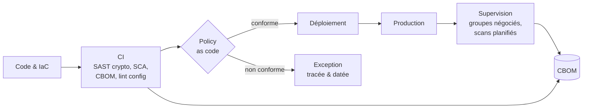

# DevSecOps

La migration PQC ne tient dans la durée que si elle est **industrialisée** : chaque nouveau service doit naître conforme, chaque régression doit être détectée automatiquement, et l'état réel de la production doit être mesuré en continu.

| Page | Contenu |
|---|---|
| [Pipeline CI/CD](pipeline.md) | Détection des usages crypto, génération du CBOM, tests TLS automatisés |
| [Policy as code](policy-as-code.md) | Règles OPA/Rego et Kyverno, gestion des exceptions |
| [Supervision](supervision.md) | Journalisation des groupes négociés, tableaux de bord, alertes |
