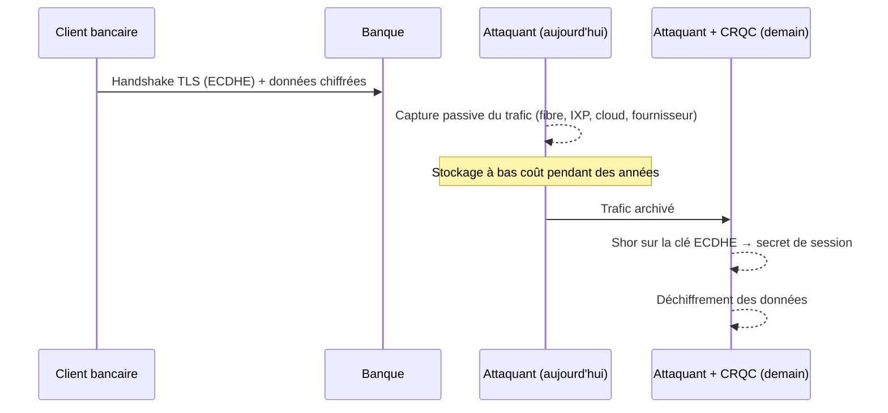

# La menace quantique

## Deux algorithmes, deux impacts très différents

| Algorithme quantique | Cible | Effet | Conséquence pratique |
|---|---|---|---|
| **Shor** (1994) | Factorisation, logarithme discret (y compris sur courbes elliptiques) | Accélération **exponentielle** | RSA, DH, ECDH, ECDSA, EdDSA, DSA sont **cassés** par un CRQC. Augmenter la taille de clé ne suffit pas. |
| **Grover** (1996) | Recherche exhaustive (clés symétriques, préimages de hachage) | Accélération **quadratique**, difficilement parallélisable | La sécurité effective est au plus divisée par deux en bits. AES-256 et SHA-384 restent largement suffisants. AES-128 reste acceptable selon la plupart des agences, mais AES-256 est recommandé pour le long terme. |

!!! note "Ce qu'on entend par CRQC"
    Un *Cryptographically Relevant Quantum Computer* est une machine tolérante aux fautes capable d'exécuter Shor sur des tailles de clés réelles (RSA-2048, P-256). Les estimations publiques ont nettement baissé ces dernières années (de l'ordre du million de qubits physiques bruités pour RSA-2048 selon des travaux de 2025, contre ~20 millions en 2019). Personne ne peut donner de date ; la gestion du risque doit donc reposer sur des **échéances réglementaires** et sur la **durée de vie des données**, pas sur un pari technologique.

## Inventaire de ce qui est touché

| Primitive | Exemples dans une banque | Statut post-quantique |
|---|---|---|
| RSA (chiffrement, signature) | Certificats TLS, signature de code, TR-34, EMV hors ligne, S/MIME | :material-close-circle:{ .statut-ko } Cassé |
| ECDH / X25519 / DH | Échange de clés TLS, IPsec, SSH, Signal-like | :material-close-circle:{ .statut-ko } Cassé — **risque HNDL immédiat** |
| ECDSA / EdDSA | Certificats, JWT (ES256), signatures de transactions, FIDO2 | :material-close-circle:{ .statut-ko } Cassé |
| AES-128 | Chiffrement de données, PIN (format 4) | :material-alert:{ .statut-warn } Marge réduite, acceptable |
| AES-256, ChaCha20 | Chiffrement de données, TLS | :material-check-circle:{ .statut-ok } Sûr |
| 3DES / TDEA | Héritage paiement (clés de zone, PIN format 0) | :material-close-circle:{ .statut-ko } Déjà obsolète indépendamment du quantique |
| SHA-256 / SHA-384 / SHA-3, HMAC | Intégrité, KDF, MAC | :material-check-circle:{ .statut-ok } Sûr |

## Harvest Now, Decrypt Later

L'attaque est **passive** : aucune alerte côté banque. Elle ne nécessite que l'accès au trafic chiffré, ce qui est réaliste pour un acteur étatique. C'est pourquoi l'**établissement de clés** (KEM) est la priorité absolue, avant les signatures.

## L'inégalité de Mosca

> Si **X + Y > Z**, vous avez déjà un problème.

- **X** : durée pendant laquelle la donnée doit rester confidentielle (ex. 10 ans pour un dossier de crédit, durée de vie du client pour des données d'identité, 5 ans pour des données de transaction selon le cadre LCB-FT) ;
- **Y** : durée nécessaire pour migrer le système concerné (dans une banque, souvent 5 à 10 ans pour un SI complet) ;
- **Z** : délai avant l'existence d'un CRQC (inconnu ; les régulateurs raisonnent avec un horizon 2030-2035).

**Exemple :** un flux interbancaire transportant des données clients à conserver 10 ans (X = 10), avec un chantier de migration de 4 ans (Y = 4), est exposé si un CRQC apparaît avant 14 ans (Z < 14), soit avant 2040. C'est largement dans la fenêtre plausible.

## Et les signatures ?

Une signature ne peut pas être « cassée rétroactivement » au sens du HNDL : la falsifier n'a d'intérêt que tant qu'elle est vérifiée. Les priorités sont donc :

- **Racines de confiance à longue durée de vie** (CA racines valides 20 ans, firmware signé d'équipements déployés 15 ans, HSM, cartes à puce) : à traiter tôt, car le remplacement est lent.
- **Signatures à valeur probante longue** (archivage électronique, contrats signés) : prévoir le re-horodatage / la re-signature avec des algorithmes PQC.
- **Signatures éphémères** (handshake TLS, JWT de 5 minutes) : à migrer avant le CRQC, mais sans urgence HNDL.
