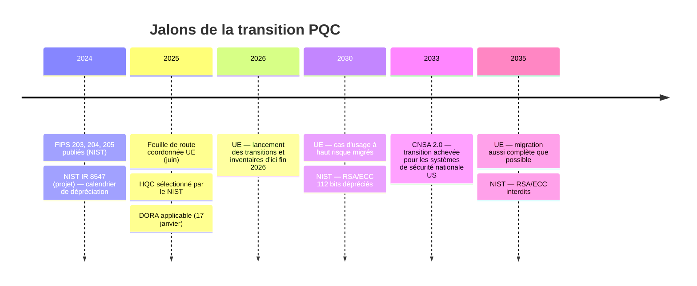

# Normes et réglementation

## Échéances clés

## France — ANSSI

Position constante depuis l'avis de 2022 et ses mises à jour :

- **Hybridation obligatoire** pendant la phase de transition pour les produits soumis à qualification, l'algorithme PQC seul n'étant pas encore considéré comme suffisamment éprouvé.
- Préférence pour des **niveaux de sécurité élevés** (ML-KEM-1024, ML-DSA-87) ; les niveaux intermédiaires sont acceptés selon les cas.
- Exceptions : les signatures à base de hachage (SLH-DSA, LMS, XMSS) peuvent être utilisées **sans hybridation**.
- Calendrier indicatif en trois phases : hybridation optionnelle → hybridation exigée pour les produits visant une qualification → possibilité à terme d'un PQC seul.

!!! info "À faire"
    Vérifiez la dernière publication de l'ANSSI avant toute décision : les positions sur les niveaux de sécurité et les dates exactes ont été précisées à plusieurs reprises.

## Union européenne

La **feuille de route coordonnée** des États membres (juin 2025, NIS Cooperation Group) fixe :

1. **Fin 2026** : premières étapes engagées — inventaires, plans de transition, sensibilisation de la chaîne d'approvisionnement ;
2. **Fin 2030** : migration des **cas d'usage à haut risque** (dont infrastructures critiques et secteur financier) ;
3. **2035** : migration achevée autant que techniquement possible.

## États-Unis — NIST et NSA

- **NIST IR 8547** : les algorithmes classiques vulnérables offrant 112 bits de sécurité (RSA-2048, P-256) sont **dépréciés en 2030** et **interdits en 2035**. Ce calendrier s'impose de fait aux fournisseurs qui visent la conformité FIPS, donc à vos HSM et à de nombreux produits.
- **CNSA 2.0** (NSA) : ML-KEM-1024, ML-DSA-87, LMS/XMSS pour le firmware, AES-256, SHA-384/512. Concerne directement les systèmes de sécurité nationale américains, mais sert de référence pour les fournisseurs.

## Allemagne — BSI

Recommandations TR-02102 : hybridation recommandée, ML-KEM-768 et ML-KEM-1024, FrodoKEM et Classic McEliece également acceptés comme alternatives conservatrices.

## Ce que cela implique pour une banque

| Exigence | Source | Traduction opérationnelle |
|---|---|---|
| Connaître sa cryptographie | PCI DSS 4.0 req. 12.3.3, feuille de route UE | CBOM tenu à jour, revu au moins annuellement |
| Politique cryptographique intégrant l'évolution de la cryptanalyse | DORA + RTS sur le cadre de gestion des risques TIC | Politique crypto mentionnant explicitement le risque quantique et la crypto-agilité |
| Gérer le risque tiers | DORA (chapitre V) | Clauses PQC dans les contrats et questionnaires fournisseurs |
| Migrer le haut risque d'ici 2030 | Feuille de route UE | Plan de migration priorisé, budgétisé et piloté |

Détails dans [Contexte bancaire › Cadre réglementaire](../banque/cadre.md).
