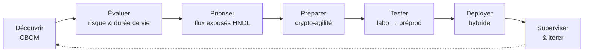

# PQC-Ops

**Migrer une infrastructure bancaire vers la cryptographie post-quantique, vu depuis la salle des machines.**

Ce site est un guide opérationnel destiné à l'ingénieur·e DevSecOps qui a les compétences en cryptographie et l'habilitation pour **conduire la migration PQC et exécuter les tests réseau et infrastructure** dans un établissement bancaire. On n'y trouvera pas un énième résumé théorique, mais des méthodes, des commandes, des critères d'acceptation et des pièges rencontrés sur le terrain.

!!! warning "Pourquoi maintenant ?"
    Les données chiffrées aujourd'hui avec RSA ou ECDH peuvent être **capturées dès maintenant et déchiffrées plus tard** (*Harvest Now, Decrypt Later*). Pour une banque, dont certaines données (identité, crédit, transactions, secrets bancaires) restent sensibles 10 à 30 ans, la fenêtre de risque est déjà ouverte. Les feuilles de route européenne et NIST fixent des jalons à **2030** puis **2035**.

-   :material-atom:{ .lg .middle } **Fondamentaux**

    ---

    La menace quantique, les algorithmes FIPS 203/204/205, les recommandations ANSSI, NIST et UE.

    [:octicons-arrow-right-24: Comprendre](fondamentaux/index.md)

-   :material-map-marker-path:{ .lg .middle } **Stratégie**

    ---

    Inventaire cryptographique (CBOM), priorisation par le risque, crypto-agilité, hybridation, feuille de route.

    [:octicons-arrow-right-24: Planifier](strategie/index.md)

-   :material-server-network:{ .lg .middle } **Infrastructure**

    ---

    TLS, IPsec, SSH, PKI et HSM, Kubernetes : quoi changer, dans quel ordre, avec quelle configuration.

    [:octicons-arrow-right-24: Migrer](infrastructure/index.md)

-   :material-lan-check:{ .lg .middle } **Tests réseau**

    ---

    Laboratoire, interopérabilité, middleboxes, MTU, performance, plan de tests et critères d'acceptation.

    [:octicons-arrow-right-24: Valider](tests/index.md)

-   :material-pipe:{ .lg .middle } **DevSecOps**

    ---

    Détection cryptographique dans la CI/CD, policy as code, supervision de la négociation en production.

    [:octicons-arrow-right-24: Industrialiser](devsecops/index.md)

-   :material-bank:{ .lg .middle } **Contexte bancaire**

    ---

    DORA, PCI DSS, flux de paiement, HSM, gouvernance, habilitations et gestion du changement.

    [:octicons-arrow-right-24: Encadrer](banque/index.md)

## Le parcours en un coup d'œil

## Principes directeurs

1. **Hybride d'abord.** En transition, on combine un algorithme classique éprouvé (X25519, ECDSA) avec un algorithme post-quantique (ML-KEM, ML-DSA). Une faille de l'un ne compromet pas l'ensemble. C'est la position de l'ANSSI et du BSI.
2. **L'échange de clés avant les signatures.** Le risque HNDL ne concerne que la confidentialité : migrer l'établissement de clés (TLS, IPsec, SSH) protège les données capturées dès aujourd'hui. Les signatures, elles, n'ont besoin d'être post-quantiques qu'avant l'arrivée d'un CRQC.
3. **On ne migre pas ce qu'on ne voit pas.** L'inventaire cryptographique est le premier livrable, et il doit rester vivant.
4. **Mesurer avant de basculer.** Taille des handshakes, latence, fragmentation, compatibilité des équipements intermédiaires : tout se teste en laboratoire puis en préproduction, jamais directement en production.
5. **La crypto-agilité est l'objectif réel.** ML-KEM ne sera pas le dernier algorithme à déployer. Le but est de rendre le prochain changement banal.

!!! info "Avertissement"
    Ce guide reflète l'état de l'art à fin 2026. Les standards, les versions logicielles et les positions des agences évoluent : vérifiez toujours les sources primaires listées dans les [références](annexes/references.md) avant une décision d'architecture. Les commandes de test sont à exécuter **uniquement sur des systèmes pour lesquels vous disposez d'une autorisation écrite**.
