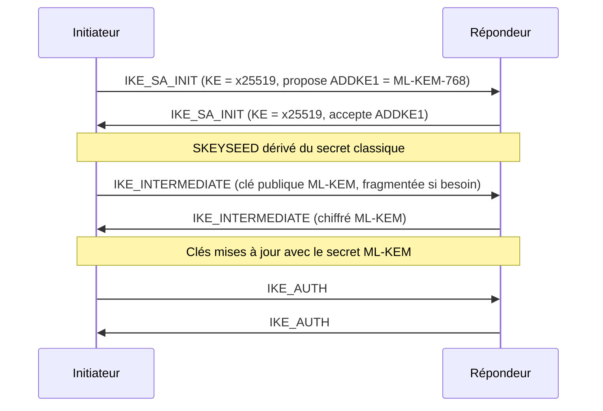

# VPN IPsec

Les tunnels IPsec inter-sites, vers les opérateurs, les partenaires et les prestataires transportent des volumes massifs de données sensibles sur des liaisons **par nature interceptables** : ce sont des cibles HNDL de premier ordre.

## Le mécanisme : échanges de clés multiples dans IKEv2

ML-KEM ne tient pas dans le message `IKE_SA_INIT` sans risque de fragmentation IP (la fragmentation IKE n'y est pas disponible). La solution standardisée :

- **RFC 9242** — échange `IKE_INTERMEDIATE`, qui intervient après `IKE_SA_INIT` et bénéficie de la fragmentation IKE (RFC 7383) ;
- **RFC 9370** — jusqu'à 7 **échanges de clés additionnels** (`ADDKE1`…`ADDKE7`), dont les secrets sont combinés ;
- Draft IETF *ikev2-mlkem* — identifiants ML-KEM pour ces échanges.



## Configuration strongSwan 6

```text
# /etc/swanctl/conf.d/site-b.conf
connections {
  site-b {
    version = 2
    proposals = aes256gcm16-prfsha384-x25519-ke1_mlkem768
    fragmentation = yes
    local  { auth = pubkey  certs = site-a.pem }
    remote { auth = pubkey  id = "CN=site-b.banque.example" }
    children {
      net {
        esp_proposals = aes256gcm16-x25519-ke1_mlkem768
        local_ts  = 10.10.0.0/16
        remote_ts = 10.20.0.0/16
      }
    }
  }
}
```

!!! note "Clés de rekey"
    Le PFS des Child SA (`esp_proposals`) doit lui aussi inclure l'échange additionnel, sinon les SA renouvelées retombent sur un secret purement classique.

## Équipements constructeurs

Le support PQC dans les pare-feux et concentrateurs VPN commerciaux progresse mais reste **hétérogène** (versions logicielles récentes, parfois matériel spécifique, parfois seulement des PPK).

| Option | Description | Sécurité post-quantique |
|---|---|---|
| **IKEv2 + ML-KEM (RFC 9370)** | Cible | :material-check-circle:{ .statut-ok } Oui |
| **PPK — RFC 8784** (*Postquantum Preshared Keys*) | Une clé symétrique pré-partagée mélangée à la dérivation | :material-check-circle:{ .statut-ok } Oui, mais gestion de clés manuelle — **mesure transitoire acceptable** pour des liens point à point en nombre limité |
| IKEv2 classique avec groupes DH plus grands | — | :material-close-circle:{ .statut-ko } Non |
| IKEv1 | — | :material-close-circle:{ .statut-ko } À éliminer quoi qu'il arrive |

## Points de test spécifiques

- [ ] Fragmentation IKE effectivement négociée (`IKEV2_FRAGMENTATION_SUPPORTED`)
- [ ] UDP/500 et UDP/4500 : pas de filtrage des fragments ni de datagrammes > 1 500 o sur le chemin
- [ ] Interopérabilité entre constructeurs différents (site A ≠ site B)
- [ ] Comportement au rekey et à la bascule HA (état de session synchronisé)
- [ ] Temps d'établissement et de rekey sous charge (centaines de tunnels)
- [ ] Repli : que se passe-t-il si l'un des pairs ne propose pas `ke1_mlkem768` ? (doit échouer si la politique l'exige)
