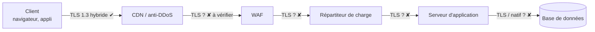

# TLS et reverse proxies

## Ce qui change dans le handshake

En TLS 1.3, l'échange de clés hybride est un simple **groupe nommé** supplémentaire. Le client envoie une *key share* `X25519MLKEM768` (1 216 o) au lieu de 32 o ; le serveur répond avec un chiffré de 1 120 o.

| Groupe | Codepoint | Composition |
|---|---|---|
| `X25519MLKEM768` | `0x11EC` | ML-KEM-768 + X25519 — **choix par défaut de l'écosystème** |
| `SecP256r1MLKEM768` | `0x11EB` | ML-KEM-768 + P-256 — pour les contextes exigeant des courbes NIST |
| `SecP384r1MLKEM1024` | `0x11ED` | ML-KEM-1024 + P-384 — aligné CNSA 2.0 / niveaux élevés |
| `X25519Kyber768Draft00` | `0x6399` | **Obsolète** (pré-standard) — à retirer s'il subsiste |

!!! warning "TLS 1.2 n'est pas concerné"
    Il n'existe pas d'échange de clés hybride standardisé pour TLS 1.2. **Migrer vers TLS 1.3 est un prérequis.** Tout flux encore en TLS 1.2 (souvent : flux B2B, équipements anciens, appliances) doit être identifié et traité en priorité.

## Configurations de référence

Les exemples suivants placent l'hybride en tête et conservent un repli classique pour les clients qui ne le prennent pas en charge.

=== "nginx (OpenSSL 3.5+)"

    ```nginx
    ssl_protocols TLSv1.3 TLSv1.2;
    ssl_prefer_server_ciphers off;
    # Hybride d'abord, repli classique
    ssl_ecdh_curve X25519MLKEM768:X25519:secp256r1:secp384r1;
    ```

=== "HAProxy"

    ```haproxy
    global
        ssl-default-bind-options ssl-min-ver TLSv1.2
        ssl-default-bind-curves X25519MLKEM768:X25519:P-256:P-384
    ```

=== "Apache httpd"

    ```apache
    SSLProtocol -all +TLSv1.3 +TLSv1.2
    SSLOpenSSLConfCmd Groups X25519MLKEM768:X25519:secp256r1:secp384r1
    ```

=== "Envoy"

    ```yaml
    common_tls_context:
      tls_params:
        tls_minimum_protocol_version: TLSv1_2
        ecdh_curves:
          - X25519MLKEM768
          - X25519
          - P-256
    ```

=== "Politique système (RHEL)"

    ```bash
    # Sur les distributions qui le proposent (RHEL 10 notamment), un sous-module
    # de politique active les algorithmes PQC pour toutes les bibliothèques.
    update-crypto-policies --show
    update-crypto-policies --set DEFAULT:PQ   # nom exact à vérifier selon la version
    ```

## HelloRetryRequest : un détail qui coûte un aller-retour

Si le client n'envoie pas de *key share* pour un groupe que le serveur préfère, le serveur répond par un **HelloRetryRequest**, ce qui ajoute un aller-retour complet. Deux points de vigilance :

- OpenSSL 3.5 envoie par défaut deux *key shares* (`X25519MLKEM768` et `X25519`), ce qui évite l'HRR dans la plupart des cas ;
- Un serveur configuré pour **exiger** ML-KEM face à un client qui n'envoie que X25519 forcera un HRR — à mesurer en test de performance.

## Terminaison TLS et chaîne complète

L'hybride ne protège que **le segment** sur lequel il est négocié. Dans une architecture bancaire typique :



Chaque saut doit être inventorié et migré. Le maillon le plus faible fixe le niveau de protection HNDL de la donnée.

## Certificats

À ce stade, **ne pas migrer les certificats TLS publics** : les navigateurs et les CA publiques ne prennent pas encore en charge ML-DSA dans le Web PKI, et l'ajout de ~15 Ko au handshake pose de vrais problèmes de performance. Les travaux (Merkle Tree Certificates, certificats composites, réduction de chaîne) sont à suivre. Pour la **PKI interne** (mTLS), le pilote est possible : voir [PKI et HSM](pki-hsm.md).

## Vérifier rapidement

```bash
openssl s_client -connect api.banque.example:443 -groups X25519MLKEM768 -brief </dev/null 2>&1 \
  | grep -E "Protocol|group|Cipher"
# Attendu (OpenSSL 3.5+) :
#   Protocol version: TLSv1.3
#   Negotiated TLS1.3 group: X25519MLKEM768
```

Méthodologie complète dans [Tests d'interopérabilité TLS](../tests/tls.md).
