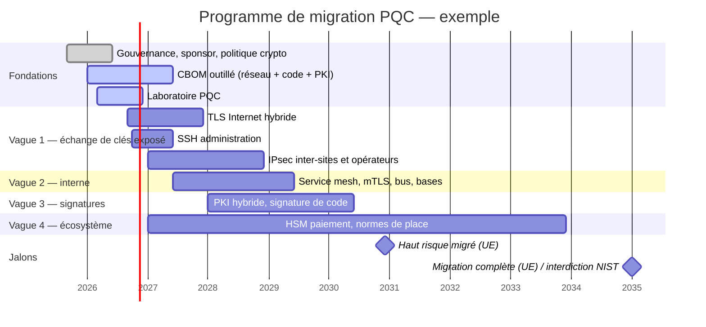

# Feuille de route

Proposition de plan aligné sur la feuille de route coordonnée de l'UE. À adapter à la taille de l'établissement et à son état de départ.

## Livrables par phase

=== "Fondations"

    - [ ] Sponsor au comité exécutif, intégration au cadre de gestion des risques TIC (DORA)
    - [ ] Politique cryptographique révisée : risque quantique, hybridation, crypto-agilité
    - [ ] CBOM initial couvrant les flux Internet et partenaires
    - [ ] Laboratoire opérationnel avec les versions cibles
    - [ ] Clauses PQC dans les appels d'offres et contrats fournisseurs
    - [ ] Formation des équipes réseau, PKI, développement

=== "Vague 1"

    - [ ] Reverse proxies et répartiteurs de charge en OpenSSL ≥ 3.5 ou équivalent
    - [ ] `X25519MLKEM768` activé en tête de liste, repli classique conservé
    - [ ] Tests middleboxes (pare-feux, WAF, proxies, IDS) validés
    - [ ] Tableau de bord du taux de négociation hybride
    - [ ] OpenSSH 10 sur bastions et serveurs, `KexAlgorithms` durci
    - [ ] Pilote IPsec hybride sur un lien inter-sites

=== "Vagues 2 et 3"

    - [ ] Service mesh avec groupes hybrides
    - [ ] Hiérarchie PKI hybride en préproduction
    - [ ] Signature de code / conteneurs en ML-DSA ou LMS
    - [ ] Schémas de données adaptés aux tailles PQC

=== "Vague 4"

    - [ ] Feuille de route constructeur HSM de paiement contractualisée
    - [ ] Participation aux groupes de place (EPC, schémas cartes, associations bancaires)
    - [ ] Plan de remplacement des flux TR-34 / RSA

## Indicateurs de pilotage

| KPI | Cible | Source |
|---|---|---|
| Couverture du CBOM (actifs inventoriés / actifs connus en CMDB) | > 95 % | CBOM × CMDB |
| Part du trafic TLS Internet négocié en hybride | Croissance suivie ; dépend des clients | Journaux des terminaisons TLS |
| Nombre de flux haut risque encore classiques | 0 en 2030 | CBOM |
| Fournisseurs critiques avec feuille de route PQC écrite | 100 % | Registre des tiers DORA |
| Délai moyen de rotation d'un algorithme (crypto-agilité) | En baisse | Exercices périodiques |
