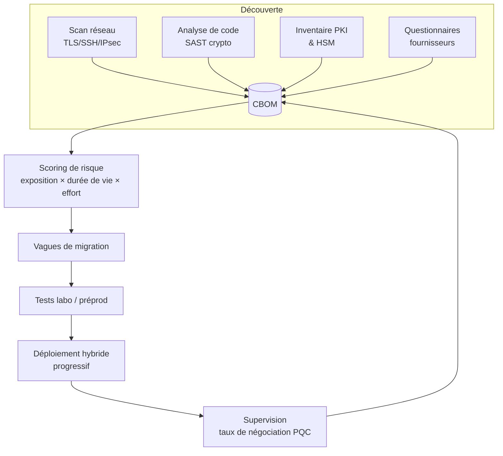

# Stratégie de migration

Une migration PQC n'est pas un projet d'infrastructure ponctuel : c'est un **programme** qui touche les réseaux, les applications, la PKI, les HSM, les fournisseurs et la gouvernance. Le rôle du DevSecOps est d'en être la **colonne vertébrale technique** : rendre l'état de la cryptographie observable, mesurable et modifiable par pipeline.

| Page | Livrable |
|---|---|
| [Inventaire et CBOM](inventaire.md) | Un inventaire cryptographique outillé, au format CycloneDX |
| [Priorisation des risques](priorisation.md) | Une matrice de scoring et des vagues de migration |
| [Crypto-agilité et hybridation](crypto-agilite.md) | Des principes d'architecture et des anti-patterns à éliminer |
| [Feuille de route](feuille-de-route.md) | Un plan pluriannuel aligné sur 2030/2035 |
