# Priorisation des risques

On ne migre pas tout en même temps. Le scoring doit refléter **la menace HNDL** (confidentialité long terme sur des flux interceptables) puis **la difficulté** de migration.

## Matrice de scoring

| Critère | 1 | 2 | 3 |
|---|---|---|---|
| **Exposition à l'interception** | Intra-hôte, segment isolé | Réseau interne, datacenter | Internet, partenaires, liaisons opérateurs, cloud public |
| **Durée de confidentialité** (X) | < 2 ans | 2 à 10 ans | > 10 ans, données d'identité, secrets bancaires |
| **Durée de migration** (Y) | Configuration | Mise à jour logicielle | Développement, matériel, fournisseur tiers, norme sectorielle |
| **Criticité métier** | Faible | Importante | Fonction critique ou importante au sens DORA |

**Score HNDL** = Exposition × Durée de confidentialité — guide la priorité de l'**échange de clés**.
**Score d'effort** = Durée de migration — détermine **quand commencer**, pas l'ordre de livraison.

!!! tip "Le paradoxe de l'effort"
    Les actifs au score d'effort maximal (HSM de paiement, équipements réseau en fin de vie, progiciels fournisseurs) sont **les premiers à engager**, car leur délai est le plus long, même s'ils seront livrés en dernier.

## Vagues typiques dans une banque

```mermaid
flowchart LR
    subgraph V1[Vague 1 — Échange de clés exposé]
        a1[TLS Internet<br/>banque en ligne, API ouvertes DSP2]
        a2[Liens inter-sites IPsec<br/>et opérateurs]
        a3[Accès d'administration SSH]
    end
    subgraph V2[Vague 2 — Interne et partenaires]
        b1[mTLS service mesh]
        b2[Flux partenaires<br/>B2B, SFTP]
        b3[Bases de données,<br/>bus de messages]
    end
    subgraph V3[Vague 3 — Signatures et confiance]
        c1[PKI interne<br/>hiérarchie hybride]
        c2[Signature de code,<br/>firmware]
        c3[Archivage probant]
    end
    subgraph V4[Vague 4 — Écosystème sectoriel]
        d1[HSM de paiement,<br/>TR-34]
        d2[Réseaux de place,<br/>cartes, EMV]
    end
    V1 --> V2 --> V3 --> V4
```

- **Vague 1** est souvent réalisable **par configuration** (OpenSSL 3.5, OpenSSH 10, navigateurs déjà prêts) : gains rapides, forte valeur de réduction de risque.
- **Vague 4** dépend de normes sectorielles (EMVCo, PCI, schémas de cartes, ISO TC68) : la banque y est suiveuse ; l'action consiste à **suivre, anticiper et contractualiser**.

## Ce qu'il ne faut pas oublier

- Les **sauvegardes chiffrées** externalisées et les **réplications** inter-sites : volumineuses, durables, très attractives pour un HNDL.
- Les **VPN des prestataires** et de la télémaintenance.
- Les **tunnels opérateurs** (MPLS chiffré, MACsec) dont la gestion de clés repose souvent sur IKE ou sur des mécanismes propriétaires.
- Le **trafic vers les fournisseurs cloud** et SaaS : vérifier le support PQC de leurs points de terminaison.
