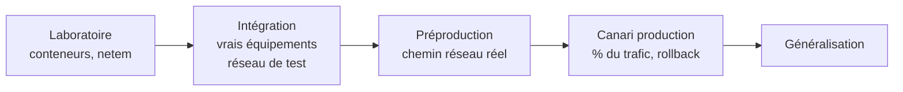

# Tests réseau et infrastructure

Les risques d'une migration PQC sont rarement cryptographiques : ce sont des **problèmes réseau**. Des messages de handshake plus gros révèlent des bogues latents dans les pare-feux, les proxies, les IDS, les répartiteurs de charge et les piles TCP qui supposaient implicitement qu'un ClientHello tient dans un seul paquet.

| Page | Objet |
|---|---|
| [Laboratoire de test](laboratoire.md) | Monter un environnement reproductible en quelques minutes |
| [Tests d'interopérabilité TLS](tls.md) | Matrice clients × serveurs × groupes, commandes et résultats attendus |
| [Middleboxes et MTU](middleboxes.md) | Fragmentation, inspection TLS, IDS, pare-feux |
| [Performance](performance.md) | Latence de handshake, CPU, débit, taille des chaînes |
| [Plan de tests](plan-de-tests.md) | Cas de test formalisés et critères d'acceptation |

!!! danger "Règle d'or"
    Tout test sur un environnement autre que le laboratoire isolé nécessite un **ordre de mission** précisant périmètre, fenêtre, contacts d'escalade et procédure d'arrêt. Voir [Gouvernance et habilitation](../banque/gouvernance.md).
