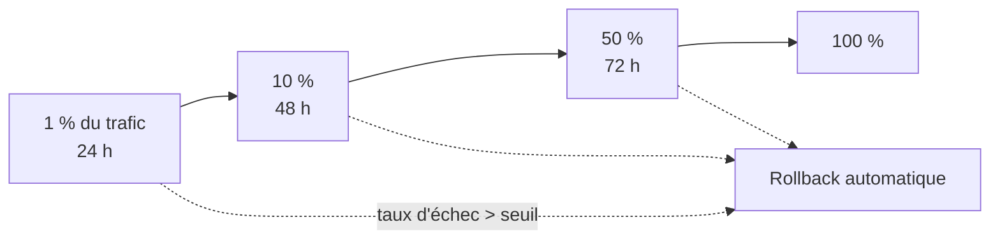

# Plan de tests

Modèle de plan de tests pour la bascule d'un frontal TLS (vague 1). À dupliquer et adapter pour IPsec, SSH et mTLS.

## Fiche d'identification

| Champ | Valeur |
|---|---|
| Périmètre | `api.banque.example` — frontal HAProxy, WAF, CDN |
| Changement | Ajout de `X25519MLKEM768` en tête des groupes TLS 1.3 |
| Environnements | Laboratoire → intégration → préproduction → canari production |
| Référence du changement | CHG-XXXX (gestion des changements) |
| Ordre de mission | OM-XXXX — périmètre IP, fenêtre, contacts |
| Responsable technique | DevSecOps PQC |
| Validation | Responsable de l'application, RSSI, exploitation réseau |

## Cas de test

| ID | Objectif | Procédure | Résultat attendu |
|---|---|---|---|
| **TLS-01** | Négociation hybride | `openssl s_client -groups X25519MLKEM768` | Groupe `X25519MLKEM768`, TLS 1.3 |
| **TLS-02** | Préférence serveur | Client proposant `X25519:X25519MLKEM768` | Hybride retenu si la politique serveur le prévoit, sans HRR superflu |
| **TLS-03** | Repli client classique | `-groups X25519` | Connexion réussie en `X25519` (profil de transition) |
| **TLS-04** | Refus si exigé | `-groups X25519` sur profil strict | Alerte `handshake_failure`, pas de blocage silencieux |
| **TLS-05** | TLS 1.2 | `-tls1_2` | Comportement conforme à la politique (accepté ou refusé) |
| **TLS-06** | Navigateurs | Playwright : Chrome, Firefox, WebKit | Pages chargées, groupe hybride observé en capture |
| **TLS-07** | Applications mobiles | Versions N et N-2 sur iOS et Android | Aucune régression fonctionnelle |
| **NET-01** | ClientHello multi-segments | MTU client 1280 puis 576 | Connexion réussie |
| **NET-02** | Traversée WAF / IPS | Comparaison direct vs via équipement | Résultats identiques, aucun `RST` émis par l'équipement |
| **NET-03** | HTTP/3 | `curl --http3` / navigateur | Connexion QUIC ou repli TCP propre |
| **NET-04** | PMTUD | `ping -M do` à différentes tailles | ICMP *frag needed* reçus |
| **PERF-01** | Latence handshake | Comparaison avant/après, netem 40 ms | Seuils de la page [Performance](performance.md) |
| **PERF-02** | Charge | Nouvelles connexions à 120 % du pic | CPU et taux d'erreurs dans les seuils |
| **OBS-01** | Traçabilité | Journaux du frontal | Groupe négocié présent dans les journaux et le SIEM |
| **RB-01** | Retour arrière | Rollback de la configuration | Retour à l'état initial en moins de 15 min, sans coupure |

## Critères de passage d'un environnement au suivant

- [ ] 100 % des cas bloquants passés (TLS-01, 03, 04, NET-01, 02, RB-01)
- [ ] Aucune anomalie de sévérité haute ouverte
- [ ] Mesures de performance dans les seuils, ou dérogation signée
- [ ] Journaux et tableaux de bord opérationnels
- [ ] Procédure de rollback testée **dans cet environnement**

## Déploiement canari

Indicateurs surveillés pendant le canari : taux d'échec de handshake par type de client (User-Agent, ASN), taux de `RST`, latence p99, tickets au support client.

## Rapport de test

Le rapport consigne : versions exactes, configurations (lien vers le commit), résultats bruts (CSV, captures anonymisées), écarts, dérogations, décision de passage et signataires. Il est archivé comme **preuve** pour l'audit (DORA, PCI DSS) et alimente le CBOM.
